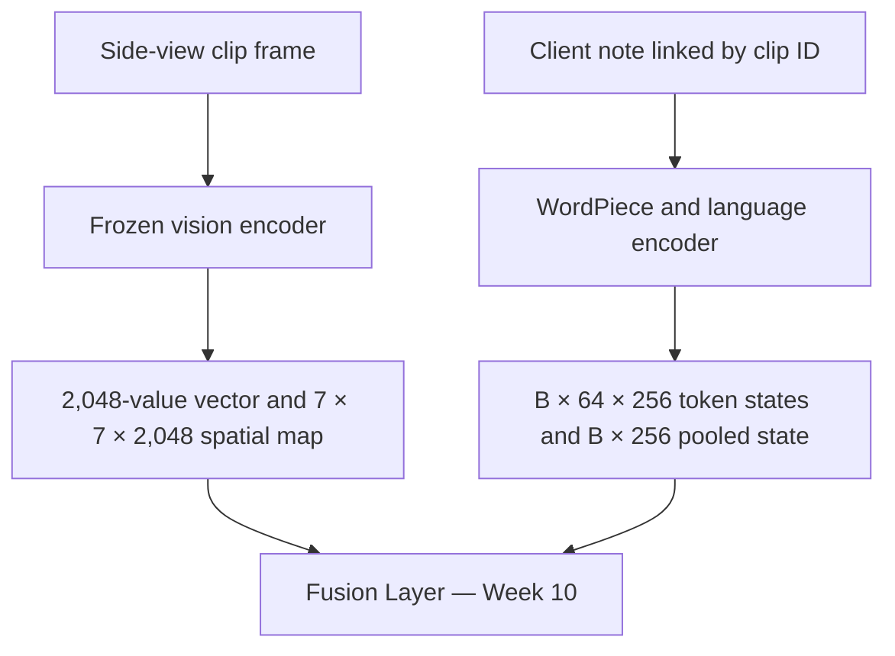
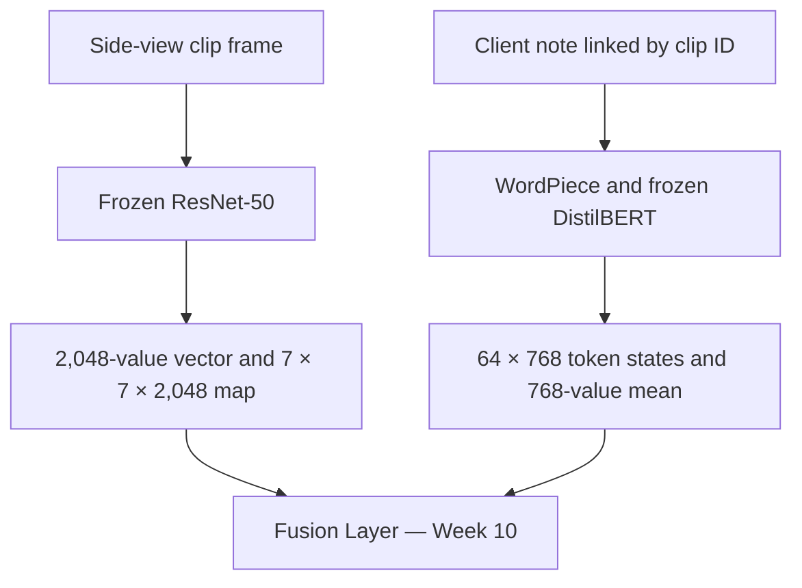
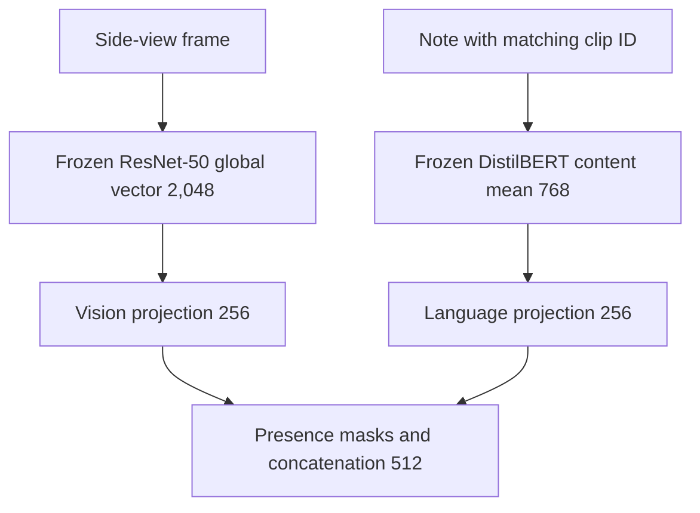
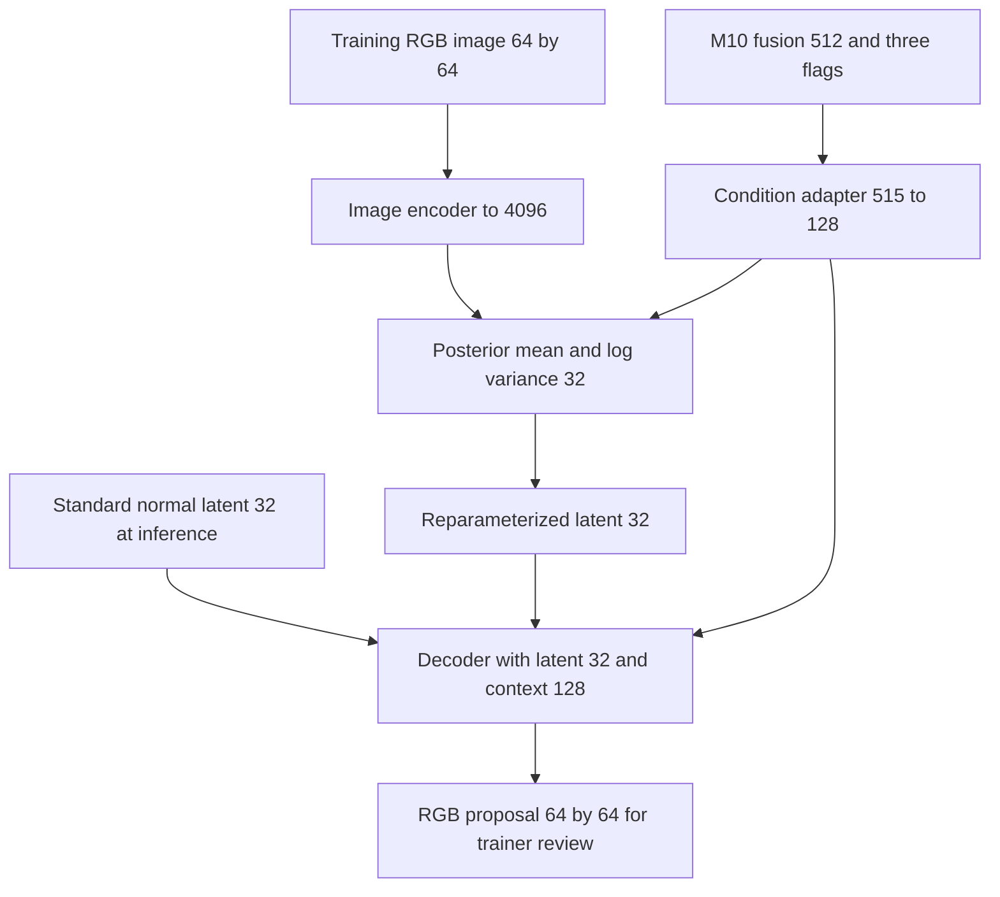
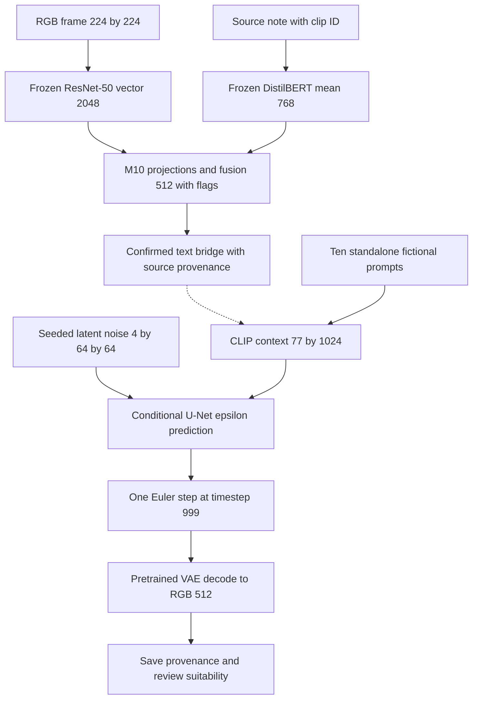

# MIPDS Architecture Record

Aaron Tobias · CSC 5352 Deep Learning · November 17, 2026

## Purpose

MIPDS supports trainer review of exercise recordings. The original prototype proposed estimating projected knee angles from side-view squat recordings using MediaPipe landmarks, timestamps, and tracking quality flags. MediaPipe and temporal analysis remain planned. The implemented coursework baseline recognizes seven exercise categories from side-view still frames, with potential use in organizing recordings for review.

The original design decisions are preserved in the [Design Philosophy](architecture_sources/Aaron_Tobias_MIPDS_Design_Philosophy.docx), [Perception Layer ADR](architecture_sources/Aaron_Tobias_MIPDS_Milestone_2_Perception_Layer_ADR_Formatted.docx), and [Training Engine Design](architecture_sources/Aaron_Tobias_MIPDS_Architecture_Record_Section_3_Training_Engine.docx).

## Current vision interfaces

| Component | Interface and semantics |
| --- | --- |
| Classifier input | RGB image. Resize the whole image to 224 × 224 with bilinear interpolation. Apply Keras ResNet-50 preprocessing outside the checkpoint, converting RGB to BGR and subtracting channel means of 103.939, 116.779, and 123.68 from unscaled pixel values. |
| Classifier output | Seven softmax scores in the run record's class order. The top score is a model score for exercise type. Milestone 6 measured the reliability of those scores. |
| Pooled feature vector | 2,048 float values from global average pooling. This tensor feeds the trained classification head. |
| Spatial feature map | 7 × 7 × 2,048 channel-last activations from ResNet-50 layer `conv5_block3_out` at 224 × 224 input. |
| Milestone 5 comparison | A separate linear probe uses a 43,008-value vector formed from flattened 1 × 1, 2 × 2, and 4 × 4 adaptive average pooling. The frozen classifier retains its original global average pooling head. |
| Milestone 5 detection | The separate COCO-pretrained YOLOv8-nano model returns box corners in oriented original-image pixels, COCO labels, and confidence scores. The provisional threshold for human review is 0.50. |

The classifier's order is `dumbbell_side_bend`, `bent_over_row`, `bicep_curl`, `push_up`, `shoulder_press`, `squat`, `triceps_extension`.

## Data and training

Version 3 of the public exercise dataset supplies the clips and exercise labels. The run samples at most 12 frames from the central 80% of each side-view clip. Frames inherit their clip's exercise label. Source form labels serve as metadata. Dataset attribution and the CC BY 4.0 license are recorded in the training notebook. [Mendeley Data, DOI 10.17632/kgbb3yn47p.3](https://data.mendeley.com/datasets/kgbb3yn47p/3)

| Split | Frames | Source clips | Participants |
| --- | ---: | ---: | ---: |
| Training | 2,531 | 213 | 17 |
| Validation | 559 | 47 | 4 |
| Test | 570 | 48 | 4 |

All seven labels appear in every split. The saved split passes overlap checks by participant, session ID, video path, and recorded frame hash. Frame counts include correlated observations from the same clips. Split membership and checkpoint selection are recorded in the [manifest](../experiments/m4_recovered/classification_manifest.csv) and [run record](../experiments/m4_recovered/m4_run_record.json).

| Earlier plan | Recovered run |
| --- | --- |
| Fine-grained squat-state classification | Seven exercise categories from public recordings |
| AdamW, five-epoch warmup, and a longer schedule | Adam at 0.0003 for 20 frozen-backbone epochs. Stage 2 started at 0.00003 with cosine decay and ended after nine epochs. |
| Broader augmentation | Small rotations and contrast changes during training |
| Checkpoint selection by validation macro-F1 | Lowest validation loss within each stage |

The classifier started from ImageNet ResNet-50 and used global average pooling, 0.30 dropout during training, and a seven-class Dense layer. Stage 2 unfroze the final two residual stages with BatchNormalization frozen. Saved checks found that the intended frozen weights stayed fixed and that the unfrozen weights changed. The checkpoint and preprocessing details are versioned by the SHA-256 digests in the run record.

## Recorded evaluation

| Validation measurement | Saved result |
| --- | ---: |
| Original classifier with frozen backbone | 59.93% accuracy |
| Original classifier after fine-tuning | 71.56% accuracy |
| Fine-tuned classifier macro-F1 | 0.7022 |
| Milestone 5 global-average linear probe | 70.84% accuracy |
| Milestone 5 multiscale linear probe | 74.60% accuracy |

The original classifier gained 11.63 percentage points on the same validation split. The Milestone 5 probes used their own linear heads. The detector comparison ran at 0.25, 0.50, and 0.75 on 20 domain images. The detector outputs support qualitative review. Measuring detection mAP requires labeled boxes and a separate evaluation.

## Milestone 6 handoff

The completed audit evaluated checkpoint `MIPDS-Vision-ResNet50-exercise-v1-0d59d2a0080d` on 570 side-view frames from 48 clips and four held-out participants. The checkpoint, split manifest, and held-out frame hashes matched the run records. Frame-level top-1 accuracy was 60.00% (342/570). The lowest class accuracies were 20.83% for bicep curl and 29.76% for squat. Mean top-score confidence was 88.28%, and top-label expected calibration error was 28.28% with ten equal-width bins.

Future fusion can consume the versioned class order, 2,048-value global vector, and 7 × 7 × 2,048 feature map. The scores express preferences among exercise classes and require trainer review in context. Pose geometry, repetition counts, and results for online-client recordings require separate evidence. [Module 6 workflow](VISION_RECOVERY_WORKFLOW.md)

## Language Input

The Milestone 7 input design is implemented by `NoteTokenizer`. A client can attach a short English note to an exercise clip. Join the note and vision evidence by `clip_id` and keep the original note available for trainer review. [Preprocessing](../mipds_language/preprocessing.py)

Normalize a copy with NFKC, standard quotes, and collapsed whitespace. Separate `lb`, `lbs`, `kg`, and `kgs` suffixes from their numeric loads and space multipliers between numbers. Use the original 30,522-entry BERT Base Uncased WordPiece vocabulary with `[PAD]=0`, `[UNK]=100`, `[CLS]=101`, and `[SEP]=102`. The vocabulary SHA-256 is `07eced375cec144d27c900241f3e339478dec958f92fddbc551f295c992038a3`. [BERT reference tokenizer](https://github.com/google-research/bert/blob/master/tokenization.py) and [published vocabulary](https://huggingface.co/google-bert/bert-base-uncased/blob/main/vocab.txt)

| Field | Type and shape | Meaning |
| --- | --- | --- |
| `input_ids` | int32 B × 64 | Ordered WordPiece IDs. Padding uses ID 0. |
| `attention_mask` | int32 B × 64 | 1 on content and boundary tokens, 0 on pads. |
| `token_type_ids` | int32 B × 64 | 0 for a normal note, first span, first separator, and pads. 1 for the second span and its separator. |
| `has_text, truncated` | bool B | Presence and whether packing removed middle content. |
| `untruncated_length, pretrim_unknown_count` | int32 B | Length with two boundary tokens on present notes and unknown content count before packing. |

Wrap a present note with `[CLS]` and `[SEP]` and right-pad to 64 positions. If the note needs more than 62 content pieces, retain the first 31 and last 30. Mark the gap with `[SEP]` and retain the final separator. A missing note produces zero masks, all pads, and zero diagnostics. Bypass the language encoder for rows with `has_text=false`.

The Milestone 8 embedding stage used 256-dimensional token, position, and segment embeddings. Position IDs run in packed order. With batch size B, the embedding layer produces B × 64 × 256 before the language encoder. The 256-wide token table has 7,813,632 parameters. Week 10 can project the text and vision streams to a common width in fusion.

The tokenizer fit 35 of 36 fictional coaching notes within 64 positions. The median and nearest-rank 95th percentile were 21 and 57. Across the 12 probe notes, one of 323 WordPieces was unknown. Twelve preprocessing checks passed, including the length boundary, missing input, and retention of a final cue in an overlength note.

## Milestone 8 Language Encoder

The recorded Milestone 8 prototype uses two bidirectional Transformer blocks with four attention heads per block, 64 channels per head, 256 hidden channels, and a 512-channel GELU feed-forward layer. Each sublayer uses pre-normalization and a residual connection. The final layer normalizes token states. The encoder has 8,885,248 parameters. [Encoder implementation](../mipds_language/encoder.py)

| Output | Type and shape | Meaning |
| --- | --- | --- |
| `token_states` | float32 B × 64 × 256 | Contextual token states in input order. Padded states are zero. |
| `cls_embedding` | float32 B × 256 | State at [CLS] for a clip-level consumer. |
| `attention_mask`, `has_text`, `truncated` | int32 B × 64 and bool B | Input flags carried into downstream review. |
| `attention` | optional float32 2 × B × 4 × 64 × 64 | Layer, batch, head, query, key. Real query rows sum to one. Padded query and key weights are zero. |

The encoder bypasses missing notes and returns zero states. Its forward path skips trailing padding in the batch and restores the fixed output shape. For the audit, a separate 771-parameter head reads the [CLS] state and predicts the reported direction.

The CPU run used 180 train, 36 validation, and 36 test fictional notes with distinct templates and recording prefaces. Epoch 2 minimized validation loss. On held-out notes, the probe scored 27/36 (75.0%) and macro-F1 0.7535. It mislabeled four right reports as left. In one right-shift note, changing the camera word from left to right flipped the prediction to right while the reported movement stayed the same. Thirteen preprocessing, mask, shape, training, and checkpoint checks passed. A seeded repeat reproduced the metrics, attention maps, and checkpoint digest. [Run record](../experiments/m8_language/audit.json)

## Pretrained Language Stack

Milestone 9 makes `PretrainedNoteEncoder` the current feature extractor, identified as `MIPDS-Language-DistilBERT-12040accade4-mean-v1`. It loads `distilbert/distilbert-base-uncased` at revision `12040accade4e8a0f71eabdb258fecc2e7e948be`. The Safetensors file SHA-256 is `5e3f1108e3cb34ee048634875d8482665b65ac713291a7e32396fb18f6ff0063`. The base encoder has 66,362,880 parameters. [Pretrained adapter](../mipds_language/pretrained.py)

The stack retains the pinned BERT WordPiece IDs, 64-position right padding, missing-note flags, and the first-31 plus last-30 packing rule. DistilBERT uses six layers, 12 heads, width 768, and feed-forward width 3,072. Its token and position embeddings supply the input states. The legacy segment IDs remain in the preprocessing record, while the pretrained model receives IDs and the attention mask.

| Output | Type and shape | Semantics |
| --- | --- | --- |
| `token_states` | float32 B × 64 × 768 | Final contextual token states. Pads are zero. |
| `pooled_embedding` | float32 B × 768 | Mean over content tokens, excluding [CLS], [SEP], and padding. |
| `attention_mask` | int32 B × 64 | 1 on active positions and 0 on padding. |
| `has_text`, `truncated` | bool B | Presence and truncation flags. |
| `attention` | optional float32 6 × B × 12 × 64 × 64 | Layer, batch, head, query, key. Padding rows and columns are zero. |
| `model_version` | string | Frozen model revision and mean-pooling adapter. |

Missing rows bypass the encoder and receive zero states. The initial adaptation strategy freezes the encoder and fits a 2,307-parameter readout on cached mean features. All 16 integration checks passed. A repeated inference and an encoder-state digest verify deterministic extraction and fixed weights during the head experiment. The readout scored 25/36 fictional test notes (69.4%, macro-F1 0.6824), with epoch 2 selected by validation cross-entropy. The experiment reuses the Milestone 8 template split. [Audit results](../experiments/m9_pretrained/audit.json)

The pretraining corpus is English Wikipedia plus Toronto BookCorpus according to the DistilBERT paper. BERT reports 2.5 billion and 800 million words for these sources. Bandy and Vincent's BookCorpus audit documents duplication, genre imbalance, and copyright restrictions in the collection they studied. The model card records inherited bias. Client-note evaluation requires data representing the intended language and recording context. [DistilBERT paper](https://arxiv.org/abs/1910.01108), [BERT data](https://arxiv.org/abs/1810.04805), and [BookCorpus audit](https://arxiv.org/abs/2105.05241)

Week 10 will consume the 768-wide language vector and the 2,048-wide vision vector, with token states and the 7 × 7 × 2,048 image map available for attention. The model-version change identifies the wider states and mean-pooling output.

## Multimodal Fusion Layer

Milestone 10 connects the 2,048-value global vision vector to the 768-value DistilBERT content mean with feature-level concatenation. Each stream has an affine projection to 256 channels, LayerNorm, and GELU. The vision branch has 525,056 trainable parameters and the text branch has 197,376. Their concatenation produces 512 channels. [Fusion implementation](../mipds_fusion/fusion.py)

The adapter requires the recorded vision and language model versions and equal clip IDs in the same row order. It validates feature widths, float32 dtypes, boolean flags, and finite values in present modalities. Absent input placeholders are zeroed before projection, and the corresponding projected block is zeroed afterward.

| Output | Type and shape | Meaning |
| --- | --- | --- |
| `fused_embedding` | float32 B × 512 | Vision channels 0–255 followed by text channels 256–511. |
| `modality_mask` | bool B × 2 | Vision then text availability. |
| `has_information` | bool B | At least one input is present. |
| `text_truncated` | bool B | Language truncation flag carried to downstream review. |
| `model_version` | string | `MIPDS-Fusion-ProjectedConcat-256x2-v1`. |

The initial fusion state uses seed 5352. The integration audit loaded the recorded Milestone 6 embedding archive and checked all 570 frame IDs and labels against the original test manifest. Seven selected frames were paired with fictional notes to exercise the connection. All 24 checks passed, including missing modalities, input rejection, branch sensitivity, nonzero gradients in both projections, and checkpoint reload. The gradient test restored the initial fusion state after one temporary optimizer step. [Audit results](../experiments/m10_fusion/audit.json)

The recorded fusion projections have not been fitted on paired training examples. Evaluation of a learned multimodal target requires annotated clip-note data grouped by client and clip across splits. The current outputs supply a typed connection for the next module. [Milestone 10 document](milestones/Aaron_Tobias_MIPDS_Milestone_10_Multimodal_Fusion_Layer.docx)

## Generative Module

Milestone 11 selects a conditional variational autoencoder for illustrative 64 × 64 RGB exercise setup thumbnails. The proposed output supports trainer review of recording context. The implemented model defines an untrained architecture, version `MIPDS-Generative-CVAE64-z32-c128-v1`. Its output does not establish movement geometry or a validated coaching recommendation. [Implementation](../mipds_generative/cvae.py)

### Components and dimensions

| Component | Exact specification |
| --- | --- |
| Fusion input | `MIPDS-Fusion-ProjectedConcat-256x2-v1`, finite float32 B × 512, B positive. Vision precedes text. |
| Condition input | Concatenate 512 features, vision presence, text presence, and text truncation, in that order. Boolean flags are cast to float32, producing B × 515. |
| Condition adapter | Linear 515 → 256, SiLU, Linear 256 → 128, LayerNorm over 128 channels, SiLU. Output context is B × 128. |
| Training target | Approved RGB setup image, resized with bilinear interpolation to 64 × 64, channel-first float32 values in [0, 1]. This preprocessing is separate from the ResNet input path. |
| Image encoder | Four Conv2d layers, kernel 4, stride 2, padding 1, channels 3 → 32 → 64 → 128 → 256. SiLU follows each convolution. Output B × 256 × 4 × 4 flattens to B × 4,096. |
| Approximate posterior | Concatenate 4,096 image values and 128 context values. Linear 4,224 → 256 with SiLU, then separate Linear 256 → 32 mean and log-variance heads. Clamp log variance to [−12, 12]. |
| Latent sampling | Training uses mean plus standard deviation times standard-normal noise. Generation samples B × 32 from a fixed standard-normal prior, independently of the condition. |
| Decoder | Concatenate latent 32 and context 128. Linear 160 → 4,096 with SiLU, reshape to B × 256 × 4 × 4. Four ConvTranspose2d layers with kernel 4, stride 2, padding 1 use channels 256 → 128 → 64 → 32 → 3. Hidden stages use SiLU, final stage uses Sigmoid. |
| Model size | 3,302,787 parameters, including 165,248 in the condition adapter. The separate M10 fusion module has 722,432 parameters. |

The same 128-value context reaches the posterior and the decoder. A fixed normal prior keeps the first implementation compact. This is a conditional-decoder VAE variant, rather than the learned conditional prior in the structured-output model of Sohn et al. [Kingma and Welling](https://arxiv.org/abs/1312.6114) and [Sohn et al.](https://papers.nips.cc/paper_files/paper/2015/hash/8d55a249e6baa5c06772297520da2051-Abstract.html)

### Integration and output contract

The routing layer joins frame features and notes by clip ID through the M10 adapter, then passes its `FusionOutput` to the VAE. The generative adapter checks the fusion version, dimensions, float32 values, flag consistency, and zero blocks for absent modalities. Vision-only and text-only inputs are permitted. Rows with neither modality and empty batches are rejected. `sample` takes the same clip IDs and an explicit integer seed. It samples the prior and decodes without a target image. The posterior image encoder is used during training and reconstruction checks.

| Generated output | Contract |
| --- | --- |
| `pixels` | float32 B × 3 × 64 × 64 in [0, 1]. |
| `clip_ids` | Tuple of B nonempty IDs supplied by the routing layer. |
| `modality_mask`, `text_truncated` | Original bool B × 2 and bool B flags. |
| `seed` | Sampling seed for the local PyTorch generator. |
| `model_version`, `fusion_version` | Generator and source fusion interface versions. |
| `requires_trainer_review` | Always true. |

### Training plan and current evidence

The implemented objective averages a per-image unit-variance Gaussian reconstruction negative log likelihood, omitting its constant term, plus beta times the Gaussian posterior-to-standard-normal KL divergence. The reconstruction term is half the sum of squared pixel errors; KL sums over 32 latent channels. Both terms average over the batch. A proposed training run would warm beta from zero to one over ten epochs and use a fixed beta of one for validation. These are initial design choices, awaiting validation.

Training requires actual approved target images paired with source clip features and accurate notes. Preserve the participant and source-clip boundaries before fitting. Keep the existing M6 held-out test vectors for interface checks and later evaluation. The proposed training scope fits the CVAE and M10 projections jointly while the pretrained vision and language encoders remain fixed, for 4,025,219 trainable parameters. Generated thumbnails require assessment of exercise and equipment consistency, visual defects, conditioning changes, and memorization on held-out clients before use in trainer review.

The CPU architecture audit passed 30 checks. It reproduced the M10 initial fusion digest, used seven real cached vision vectors with fictional notes, and used an analytic RGB grid for image and gradient checks. All six VAE parameter groups received finite nonzero gradients. A temporary optimizer step changed the VAE and was reversed; checkpoint reload reproduced prior samples. The language and fusion states remained fixed. Both the VAE and fusion projections remain untrained on paired examples. The run establishes interface behavior and gradient flow, with image quality still unmeasured. [Audit evidence](../experiments/m11_generative/audit.json) and [Milestone 11 document](milestones/Aaron_Tobias_MIPDS_Milestone_11_Generative_Module.docx)

## Conditioned Diffusion Pipeline

Milestone 12 adds the frozen pretrained `stabilityai/sd-turbo` checkpoint at revision `b261bac6fd2cf515557d5d0707481eafa0485ec2` as the active experimental image generator. The M11 conditional VAE remains an untrained architecture baseline. SD-Turbo uses adversarial diffusion distillation of Stable Diffusion 2.1; its discriminator is a training component, while inference uses CLIP, a conditional U-Net, Euler sampling, and a pretrained VAE decoder. [Publisher model card](https://huggingface.co/stabilityai/sd-turbo/blob/b261bac6fd2cf515557d5d0707481eafa0485ec2/README.md) and [ADD paper](https://arxiv.org/abs/2311.17042)

### Selection and measured configuration

The one-step checkpoint allows a complete 512 × 512 prompting experiment on the available CPU. Its reduced sampling cost is useful for research iteration, but fine equipment placement, anatomy, and measured geometry require their own evidence. The experiment used the checkpoint's FP16 weight files converted to bfloat16, four CPU threads, seed 5352, one Euler step, and guidance scale 0.0. No negative prompt or classifier-free guidance branch was used. All 14 source files matched upstream Git or LFS digests. [Pinned model manifest](../mipds_diffusion/model_manifest.json)

| Component | Specification |
| --- | --- |
| Tokenizer | Checkpoint-native CLIP BPE, 49,408 vocabulary entries, padded to 77 positions. All ten prompts fit without truncation, with 36–42 tokens including boundaries. |
| Text encoder | `CLIPTextModel`, 23 Transformer blocks, width 1,024, 16 heads, feed-forward width 4,096. Token and positional embeddings plus final normalization return B × 77 × 1,024. This is separate from the M9 DistilBERT channel. |
| Initial latent | Seeded Gaussian B × 4 × 64 × 64 multiplied by initial sigma 14.6146469. |
| U-Net | `UNet2DConditionModel`, input and output four channels, channel stages 320, 640, 1,280, 1,280, two residual layers per down stage, timestep embedding width 1,280, and cross-attention to the CLIP states. Three cross-attention down blocks, a plain down block, cross-attention mid block, then a plain up block and three cross-attention up blocks. |
| Observed down outputs | B × 320 × 32 × 32; B × 640 × 16 × 16; B × 1,280 × 8 × 8; B × 1,280 × 8 × 8. |
| Observed up outputs | B × 1,280 × 16 × 16; B × 1,280 × 32 × 32; B × 640 × 64 × 64; B × 320 × 64 × 64. Final convolution predicts B × 4 × 64 × 64 epsilon. |
| Sampler | `EulerDiscreteScheduler`, epsilon prediction, trailing timestep spacing, one timestep at 999. Model input is scaled by the current sigma. One Euler update takes sigma from 14.6146469 to zero. |
| VAE decode | Divide the denoised latent by 0.18215. The pretrained `AutoencoderKL` uses a post-quantization convolution and RGB decoder with four block stages and an eightfold spatial expansion. Output B × 3 × 512 × 512. |
| Pixel conversion | Divide decoded RGB by two, add 0.5, clamp to [0, 1], convert channel-last, round to 8-bit, and save RGB PNG. |

The loaded components contain 340,387,840 text-encoder parameters, 865,910,724 U-Net parameters, and 83,653,863 VAE parameters. They remain fixed. The original M11 32-value latent and 128-value context are not inputs to this pretrained decoder.

### Connection to existing MIPDS modules

`prepare_prompt` accepts a M10 `FusionOutput`, its ordered source IDs, a selected row, and confirmed trainer text. It checks dimensions, version, finite values, availability flags, and absent feature blocks, then retains the source ID and flags with the description. The adapter is a routing and provenance bridge. It does not infer a caption from the 512 features or convert them into CLIP tokens. A learned neural adapter between M10 and this diffusion model would require paired training and is not implemented. [Text bridge](../mipds_diffusion/bridge.py)

The ten example generations use the standalone fictional-text entry. Bridge tests use synthetic contract fixtures. This distinction separates the demonstrated text-to-image run from an end-to-end source-video-conditioned system.

### Experiment and suitability

The run produced ten 512 × 512 RGB images in a mean of 7.02 seconds each, excluding model load and the source-file checks. All 21 technical checks passed, including intermediate shapes, finite values, token limits, bridge validation, frozen parameters, and repeatability. Repeating the first prompt with the same seed reproduced identical RGB pixels in this runtime. This does not promise identical output on different hardware or package versions. [Run record](../experiments/m12_diffusion/run_record.json)

The saved outputs received assistant-supported visual inspection. Nine fail critical constraints in their specified tasks. One is a limited generic front-view concept with unresolved hand detail. None is approved for client use. The failures include wrong camera views, floating or missing equipment, incomplete limbs, unreadable angle labels, and inconsistent movement panels. This single-seed, ten-prompt audit is exploratory and does not estimate population performance or fairness. [Prompts](../experiments/m12_diffusion/prompts.json), [all original outputs](../experiments/m12_diffusion/images), and [individual reviews](../experiments/m12_diffusion/reviews.json)

## Governance and Ethics

### Training data and consent

The publisher identifies SD-Turbo's Stable Diffusion 2.1 lineage, but the inspected card does not provide an itemized consent and rights ledger for the distillation data. Consent and copyright clearance for the entire checkpoint's training history have not been established in this project. LAION documents that its metadata license does not transfer the rights in linked images. An accessible model or dataset is not evidence of permission from every depicted person or rights holder. [LAION dataset documentation](https://laion.ai/blog/laion-5b/)

This experiment uses fictional adult exercise and equipment descriptions and performs no fine-tuning. No client videos, identifying photographs, health notes, or private names were supplied to the generator. Before any future client-data training, the project would require separate permission for model training and service use, an approved source inventory, and a deletion and retention procedure. These are planned governance requirements, not controls implemented by the current experiment.

### Copyright and model terms

The pinned checkpoint includes the Stability AI Community License dated July 5, 2024. The project uses it for academic research and records that exact file's digest. Commercial use would require reviewing the applicable terms. A model license does not settle the rights of every source image or guarantee ownership of every generated pixel. The U.S. Copyright Office's 2025 report explains that prompts alone do not establish sufficient human authorship of generated expression. The project makes no claim of exclusive copyright in these generated images. [Pinned license](https://huggingface.co/stabilityai/sd-turbo/blob/b261bac6fd2cf515557d5d0707481eafa0485ec2/LICENSE.md) and [Copyright Office report announcement](https://copyright.gov/newsnet/2025/1060.html)

### Release and trainer oversight

The checkpoint package contains no safety-checker module. The saved images were visually inspected for this report; no automated content-screening result is claimed. Prompts, seeds, checkpoint revision, software versions, output digests, and suitability decisions remain attached to the experiment. The present decision keeps all ten examples outside client use. Public release or integration into a trainer workflow would require an implemented output-approval step, appropriate content controls, and a broader audit across body types, equipment, and recording conditions.

Generated images are illustrative proposals. They must not be represented as observations of a client's movement, used to infer real joint angles, or mixed into held-out evaluation data as real examples. The current system still requires separate implementation and validation for the originally planned pose measurements. [Milestone 12 submission](milestones/Aaron_Tobias_MIPDS_Milestone_12_Conditioned_Diffusion_Pipeline.docx)
