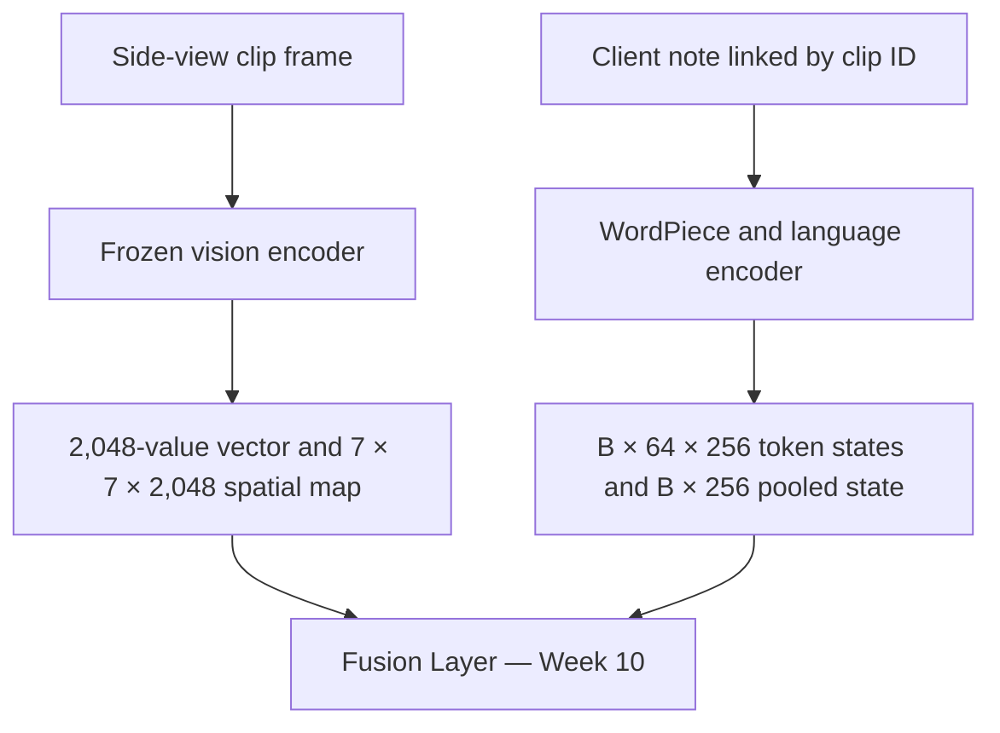
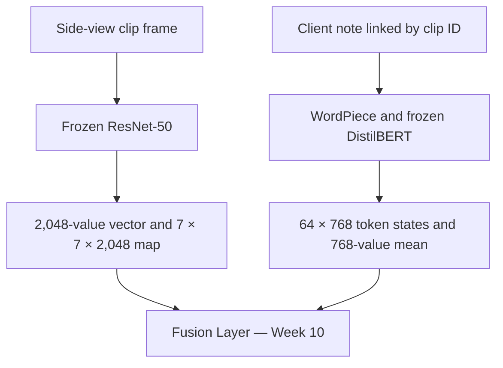

# MIPDS Architecture Record

Aaron Tobias · CSC 5352 Deep Learning · November 17, 2026

## Purpose

MIPDS supports trainer review of exercise recordings. The original prototype proposed estimating projected knee angles from side-view squat recordings using MediaPipe landmarks, timestamps, and tracking quality flags. MediaPipe and temporal analysis remain planned. The implemented coursework baseline recognizes seven exercise categories from side-view still frames, with potential use in organizing recordings for review.

The original design decisions are preserved in the [Design Philosophy](architecture_sources/Aaron_Tobias_MIPDS_Design_Philosophy.docx), [Perception Layer ADR](architecture_sources/Aaron_Tobias_MIPDS_Milestone_2_Perception_Layer_ADR_Formatted.docx), and [Training Engine Design](architecture_sources/Aaron_Tobias_MIPDS_Architecture_Record_Section_3_Training_Engine.docx).

## Current vision interfaces

| Component | Interface and semantics |
| --- | --- |
| Classifier input | RGB image. Resize the whole image to 224 × 224 with bilinear interpolation. Apply Keras ResNet-50 preprocessing outside the checkpoint, converting RGB to BGR and subtracting channel means of 103.939, 116.779, and 123.68 from unscaled pixel values. |
| Classifier output | Seven softmax scores in the run record's class order. The top score is a model score for exercise type. Milestone 6 measured the reliability of those scores. |
| Pooled feature vector | 2,048 float values from global average pooling. This tensor feeds the trained classification head. |
| Spatial feature map | 7 × 7 × 2,048 channel-last activations from ResNet-50 layer `conv5_block3_out` at 224 × 224 input. |
| Milestone 5 comparison | A separate linear probe uses a 43,008-value vector formed from flattened 1 × 1, 2 × 2, and 4 × 4 adaptive average pooling. The frozen classifier retains its original global average pooling head. |
| Milestone 5 detection | The separate COCO-pretrained YOLOv8-nano model returns box corners in oriented original-image pixels, COCO labels, and confidence scores. The provisional threshold for human review is 0.50. |

The classifier's order is `dumbbell_side_bend`, `bent_over_row`, `bicep_curl`, `push_up`, `shoulder_press`, `squat`, `triceps_extension`.

## Data and training

Version 3 of the public exercise dataset supplies the clips and exercise labels. The run samples at most 12 frames from the central 80% of each side-view clip. Frames inherit their clip's exercise label. Source form labels serve as metadata. Dataset attribution and the CC BY 4.0 license are recorded in the training notebook. [Mendeley Data, DOI 10.17632/kgbb3yn47p.3](https://data.mendeley.com/datasets/kgbb3yn47p/3)

| Split | Frames | Source clips | Participants |
| --- | ---: | ---: | ---: |
| Training | 2,531 | 213 | 17 |
| Validation | 559 | 47 | 4 |
| Test | 570 | 48 | 4 |

All seven labels appear in every split. The saved split passes overlap checks by participant, session ID, video path, and recorded frame hash. Frame counts include correlated observations from the same clips. Split membership and checkpoint selection are recorded in the [manifest](../experiments/m4_recovered/classification_manifest.csv) and [run record](../experiments/m4_recovered/m4_run_record.json).

| Earlier plan | Recovered run |
| --- | --- |
| Fine-grained squat-state classification | Seven exercise categories from public recordings |
| AdamW, five-epoch warmup, and a longer schedule | Adam at 0.0003 for 20 frozen-backbone epochs. Stage 2 started at 0.00003 with cosine decay and ended after nine epochs. |
| Broader augmentation | Small rotations and contrast changes during training |
| Checkpoint selection by validation macro-F1 | Lowest validation loss within each stage |

The classifier started from ImageNet ResNet-50 and used global average pooling, 0.30 dropout during training, and a seven-class Dense layer. Stage 2 unfroze the final two residual stages with BatchNormalization frozen. Saved checks found that the intended frozen weights stayed fixed and that the unfrozen weights changed. The checkpoint and preprocessing details are versioned by the SHA-256 digests in the run record.

## Recorded evaluation

| Validation measurement | Saved result |
| --- | ---: |
| Original classifier with frozen backbone | 59.93% accuracy |
| Original classifier after fine-tuning | 71.56% accuracy |
| Fine-tuned classifier macro-F1 | 0.7022 |
| Milestone 5 global-average linear probe | 70.84% accuracy |
| Milestone 5 multiscale linear probe | 74.60% accuracy |

The original classifier gained 11.63 percentage points on the same validation split. The Milestone 5 probes used their own linear heads. The detector comparison ran at 0.25, 0.50, and 0.75 on 20 domain images. The detector outputs support qualitative review. Measuring detection mAP requires labeled boxes and a separate evaluation.

## Milestone 6 handoff

The completed audit evaluated checkpoint `MIPDS-Vision-ResNet50-exercise-v1-0d59d2a0080d` on 570 side-view frames from 48 clips and four held-out participants. The checkpoint, split manifest, and held-out frame hashes matched the run records. Frame-level top-1 accuracy was 60.00% (342/570). The lowest class accuracies were 20.83% for bicep curl and 29.76% for squat. Mean top-score confidence was 88.28%, and top-label expected calibration error was 28.28% with ten equal-width bins.

Future fusion can consume the versioned class order, 2,048-value global vector, and 7 × 7 × 2,048 feature map. The scores express preferences among exercise classes and require trainer review in context. Pose geometry, repetition counts, and results for online-client recordings require separate evidence. [Module 6 workflow](VISION_RECOVERY_WORKFLOW.md)

## Language Input

The Milestone 7 input design is implemented by `NoteTokenizer`. A client can attach a short English note to an exercise clip. Join the note and vision evidence by `clip_id` and keep the original note available for trainer review. [Preprocessing](../mipds_language/preprocessing.py)

Normalize a copy with NFKC, standard quotes, and collapsed whitespace. Separate `lb`, `lbs`, `kg`, and `kgs` suffixes from their numeric loads and space multipliers between numbers. Use the original 30,522-entry BERT Base Uncased WordPiece vocabulary with `[PAD]=0`, `[UNK]=100`, `[CLS]=101`, and `[SEP]=102`. The vocabulary SHA-256 is `07eced375cec144d27c900241f3e339478dec958f92fddbc551f295c992038a3`. [BERT reference tokenizer](https://github.com/google-research/bert/blob/master/tokenization.py) and [published vocabulary](https://huggingface.co/google-bert/bert-base-uncased/blob/main/vocab.txt)

| Field | Type and shape | Meaning |
| --- | --- | --- |
| `input_ids` | int32 B × 64 | Ordered WordPiece IDs. Padding uses ID 0. |
| `attention_mask` | int32 B × 64 | 1 on content and boundary tokens, 0 on pads. |
| `token_type_ids` | int32 B × 64 | 0 for a normal note, first span, first separator, and pads. 1 for the second span and its separator. |
| `has_text, truncated` | bool B | Presence and whether packing removed middle content. |
| `untruncated_length, pretrim_unknown_count` | int32 B | Length with two boundary tokens on present notes and unknown content count before packing. |

Wrap a present note with `[CLS]` and `[SEP]` and right-pad to 64 positions. If the note needs more than 62 content pieces, retain the first 31 and last 30. Mark the gap with `[SEP]` and retain the final separator. A missing note produces zero masks, all pads, and zero diagnostics. Bypass the language encoder for rows with `has_text=false`.

The Milestone 8 embedding stage used 256-dimensional token, position, and segment embeddings. Position IDs run in packed order. With batch size B, the embedding layer produces B × 64 × 256 before the language encoder. The 256-wide token table has 7,813,632 parameters. Week 10 can project the text and vision streams to a common width in fusion.

The tokenizer fit 35 of 36 fictional coaching notes within 64 positions. The median and nearest-rank 95th percentile were 21 and 57. Across the 12 probe notes, one of 323 WordPieces was unknown. Twelve preprocessing checks passed, including the length boundary, missing input, and retention of a final cue in an overlength note.

## Milestone 8 Language Encoder

The recorded Milestone 8 prototype uses two bidirectional Transformer blocks with four attention heads per block, 64 channels per head, 256 hidden channels, and a 512-channel GELU feed-forward layer. Each sublayer uses pre-normalization and a residual connection. The final layer normalizes token states. The encoder has 8,885,248 parameters. [Encoder implementation](../mipds_language/encoder.py)

| Output | Type and shape | Meaning |
| --- | --- | --- |
| `token_states` | float32 B × 64 × 256 | Contextual token states in input order. Padded states are zero. |
| `cls_embedding` | float32 B × 256 | State at [CLS] for a clip-level consumer. |
| `attention_mask`, `has_text`, `truncated` | int32 B × 64 and bool B | Input flags carried into downstream review. |
| `attention` | optional float32 2 × B × 4 × 64 × 64 | Layer, batch, head, query, key. Real query rows sum to one. Padded query and key weights are zero. |

The encoder bypasses missing notes and returns zero states. Its forward path skips trailing padding in the batch and restores the fixed output shape. For the audit, a separate 771-parameter head reads the [CLS] state and predicts the reported direction.

The CPU run used 180 train, 36 validation, and 36 test fictional notes with distinct templates and recording prefaces. Epoch 2 minimized validation loss. On held-out notes, the probe scored 27/36 (75.0%) and macro-F1 0.7535. It mislabeled four right reports as left. In one right-shift note, changing the camera word from left to right flipped the prediction to right while the reported movement stayed the same. Thirteen preprocessing, mask, shape, training, and checkpoint checks passed. A seeded repeat reproduced the metrics, attention maps, and checkpoint digest. [Run record](../experiments/m8_language/audit.json)

## Pretrained Language Stack

Milestone 9 makes `PretrainedNoteEncoder` the current feature extractor, identified as `MIPDS-Language-DistilBERT-12040accade4-mean-v1`. It loads `distilbert/distilbert-base-uncased` at revision `12040accade4e8a0f71eabdb258fecc2e7e948be`. The Safetensors file SHA-256 is `5e3f1108e3cb34ee048634875d8482665b65ac713291a7e32396fb18f6ff0063`. The base encoder has 66,362,880 parameters. [Pretrained adapter](../mipds_language/pretrained.py)

The stack retains the pinned BERT WordPiece IDs, 64-position right padding, missing-note flags, and the first-31 plus last-30 packing rule. DistilBERT uses six layers, 12 heads, width 768, and feed-forward width 3,072. Its token and position embeddings supply the input states. The legacy segment IDs remain in the preprocessing record, while the pretrained model receives IDs and the attention mask.

| Output | Type and shape | Semantics |
| --- | --- | --- |
| `token_states` | float32 B × 64 × 768 | Final contextual token states. Pads are zero. |
| `pooled_embedding` | float32 B × 768 | Mean over content tokens, excluding [CLS], [SEP], and padding. |
| `attention_mask` | int32 B × 64 | 1 on active positions and 0 on padding. |
| `has_text`, `truncated` | bool B | Presence and truncation flags. |
| `attention` | optional float32 6 × B × 12 × 64 × 64 | Layer, batch, head, query, key. Padding rows and columns are zero. |
| `model_version` | string | Frozen model revision and mean-pooling adapter. |

Missing rows bypass the encoder and receive zero states. The initial adaptation strategy freezes the encoder and fits a 2,307-parameter readout on cached mean features. All 16 integration checks passed. A repeated inference and an encoder-state digest verify deterministic extraction and fixed weights during the head experiment. The readout scored 25/36 fictional test notes (69.4%, macro-F1 0.6824), with epoch 2 selected by validation cross-entropy. The experiment reuses the Milestone 8 template split. [Audit results](../experiments/m9_pretrained/audit.json)

The pretraining corpus is English Wikipedia plus Toronto BookCorpus according to the DistilBERT paper. BERT reports 2.5 billion and 800 million words for these sources. Bandy and Vincent's BookCorpus audit documents duplication, genre imbalance, and copyright restrictions in the collection they studied. The model card records inherited bias. Client-note evaluation requires data representing the intended language and recording context. [DistilBERT paper](https://arxiv.org/abs/1910.01108), [BERT data](https://arxiv.org/abs/1810.04805), and [BookCorpus audit](https://arxiv.org/abs/2105.05241)

Week 10 will consume the 768-wide language vector and the 2,048-wide vision vector, with token states and the 7 × 7 × 2,048 image map available for attention. The model-version change identifies the wider states and mean-pooling output.

